

<a href="https://healthcare.skotechlabs.com">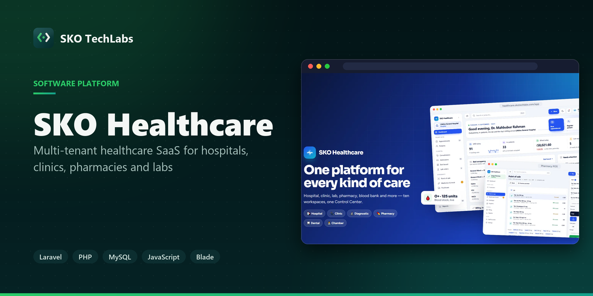</a>

<h3>Multi-tenant healthcare SaaS for hospitals, clinics, pharmacies and labs</h3>

One cloud platform that runs ten kinds of care businesses: hospitals, clinics, diagnostic centres, pharmacies, dental clinics, doctor chambers, nursing homes, physiotherapy centres, blood banks and laboratories — each with its own workspace, plus a Control Center that manages the whole platform and its website.

   

<a href="https://healthcare.skotechlabs.com"><b>Live Demo</b></a> &nbsp;·&nbsp; <a href="https://skotechlabs.com/projects/sko-healthcare-hospital-clinic-pharmacy-lab-saas"><b>Case Study</b></a> &nbsp;·&nbsp; <a href="https://skotechlabs.com/contact"><b>Request a Demo</b></a> &nbsp;·&nbsp; <a href="https://github.com/skotechlabs"><b>All Products</b></a>

---

## Overview

SKO Healthcare is a multi-tenant healthcare SaaS built for Bangladesh. When a facility signs up it picks its business type and its workspace arrives with the right modules, words, dashboards, price list and prints already in place — a hospital gets OPD queues, admissions and a live bed board, a pharmacy gets a fast point of sale with batch and expiry control, a blood bank gets donor screening and component stock, and a nursing home gets residents, care notes and medication rounds.

Every department works on the same patient record. Appointments with serial tokens flow into consultations and a prescription writer that prints on the facility's letterhead with a QR code anyone can scan to verify it. Lab orders move from sample collection to verified reports with abnormal values flagged automatically, admissions add bed charges day by day and discharge with one bill, and every charge — consultations, tests, medicines, therapy courses, dental work, monthly care fees and blood units — lands on invoices with split payments and clear dues.

Patients can book online from each facility's own booking page, visitors can open a live demo of any facility type in one click, and the SKO Control Center lets the team approve facilities, manage plans, subscriptions and invoices, switch modules per facility type, maintain the medicine and lab test libraries, answer support tickets and edit every part of the public website without touching code.

<table>
<tr>
<td width="50%" valign="top">

### The Challenge

Care businesses in Bangladesh run on paper registers, spreadsheets and separate tools that never talk to each other, so doctors miss history, pharmacies lose track of expiry, labs chase reports by phone and accounts miss charges. One product had to serve very different businesses — from a single doctor chamber to a hospital, a blood bank and a nursing home — without becoming a cluttered ERP, keep every facility private from the others, and let a small team run the whole platform without developers.

</td>
<td width="50%" valign="top">

### Our Solution

We built a multi-tenant Laravel platform where the facility type decides the modules, terminology, dashboards and starter data, while one shared patient record connects every department. Domain services keep the hard rules correct — invoice totals and dues, first-expiry-first stock, bed occupancy, blood unit quarantine, compatibility and expiry — and a schema-driven admin framework powers both the workspaces and the Control Center. The clean, calm interface was designed for busy front desks and works on phones, prints use QR verification, and a nightly rebuild keeps the ten showcase facilities full of realistic, up-to-date demo data.

</td>
</tr>
</table>

## Key Features

- Ten ready-made workspaces: Hospital, Clinic, Diagnostic Center, Pharmacy, Dental Clinic, Doctor Chamber, Nursing Home, Physiotherapy Center, Blood Bank and Medical Laboratory
- Front desk queue board with serial tokens, walk-ins, online bookings, check-in, consultation and billing in one place
- Prescription writer with vitals, medicine suggestions, dose shortcuts, tests and QR-verified printing
- In-patient admissions with a live bed board, daily bed charges, transfers and one-bill discharge summaries
- Laboratory orders from sample collection to verified reports, with reference ranges and automatic abnormal flags
- Pharmacy point of sale with barcode search, first-expiry-first batches, purchases, suppliers and stock alerts
- Dental tooth chart with treatment plans, and physiotherapy courses with session scheduling and pain progress
- Nursing home residents, care notes, vitals and medication rounds recorded in a tap
- Blood bank donors and screening, component stock by group, compatible cross-match and issue with billing
- Invoices from every department with split payments, dues, receipts, reports and CSV exports
- Online booking page for every facility, role-based staff access and a live demo for each facility type
- SKO Control Center: facilities, approvals, plans, subscriptions, module matrix, libraries, support tickets, website content and settings

## Business Impact

- Ten facility types served from one codebase and one Control Center
- A new facility can sign up and start seeing patients in minutes with its starter setup ready
- Every bill, stock movement and blood unit stays consistent through shared domain rules
- Each facility has its own online booking page and QR-verifiable prints
- Live demo of every facility type, refreshed every night

## Screenshots

<table>
<tr>
<td width="50%" valign="top">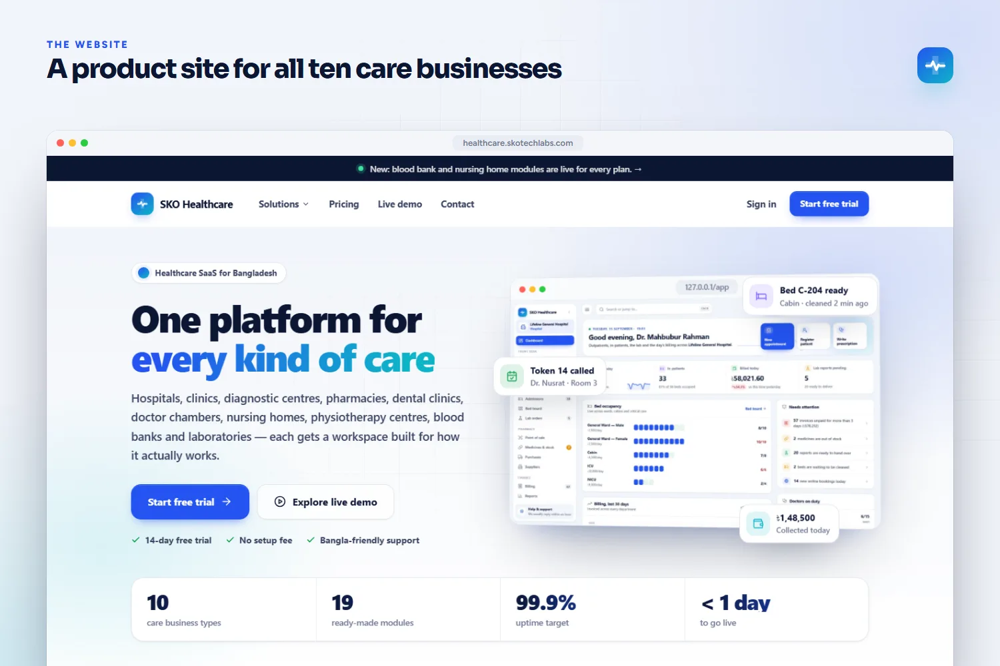 The public website for all ten care businesses</td>
<td width="50%" valign="top">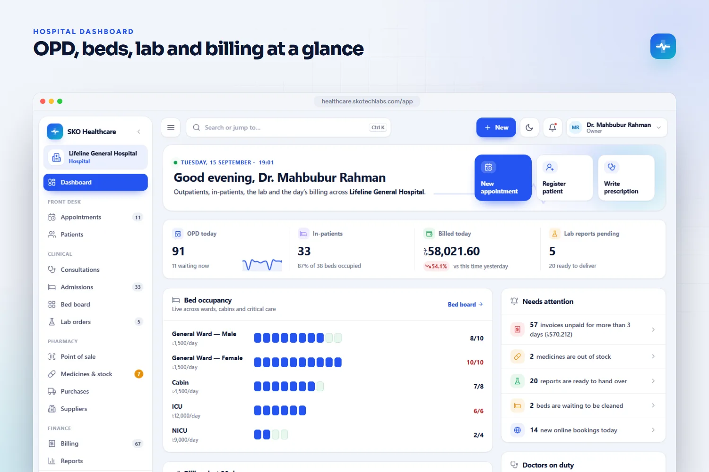 Hospital dashboard with OPD, beds, lab and billing at a glance</td>
</tr>
<tr>
<td width="50%" valign="top">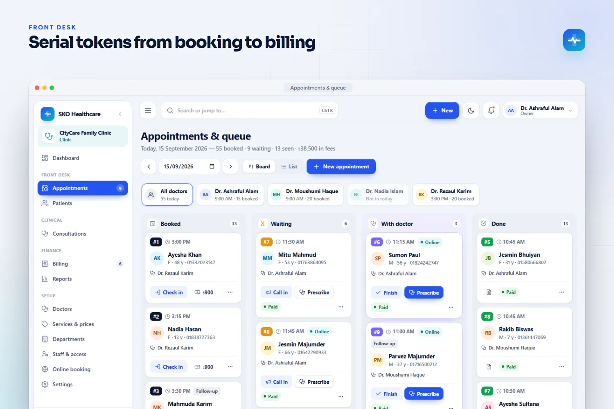 Front desk queue board with serial tokens</td>
<td width="50%" valign="top">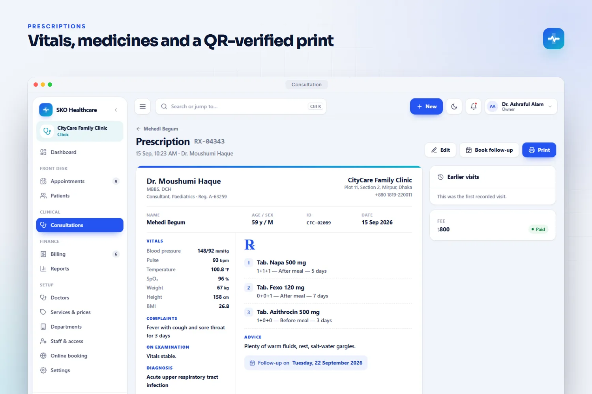 Prescription with vitals, medicines and a QR-verified print</td>
</tr>
<tr>
<td width="50%" valign="top">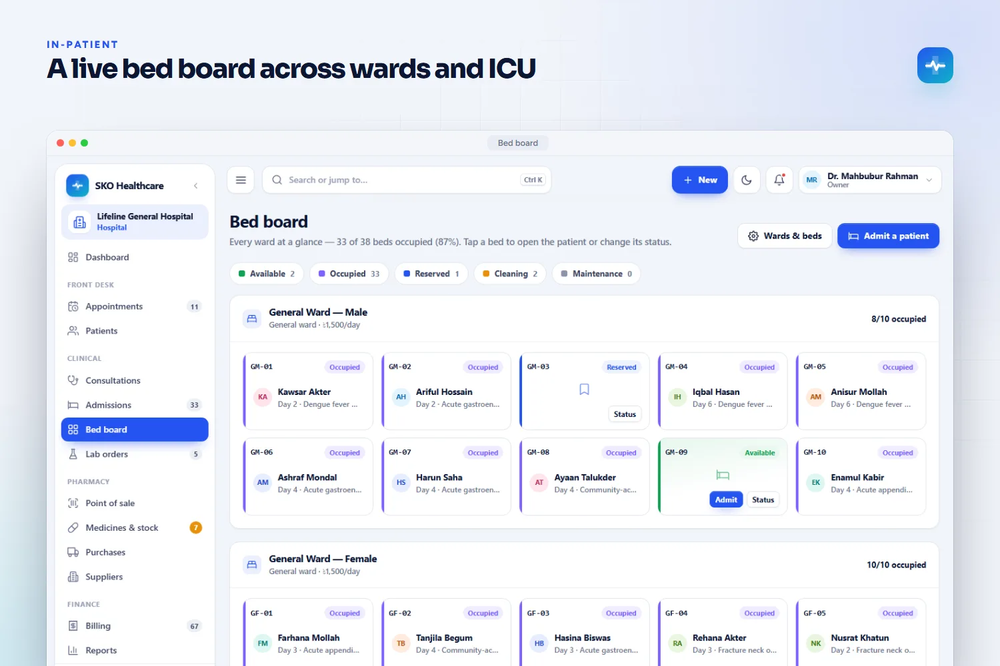 Live bed board across wards, cabins and ICU</td>
<td width="50%" valign="top">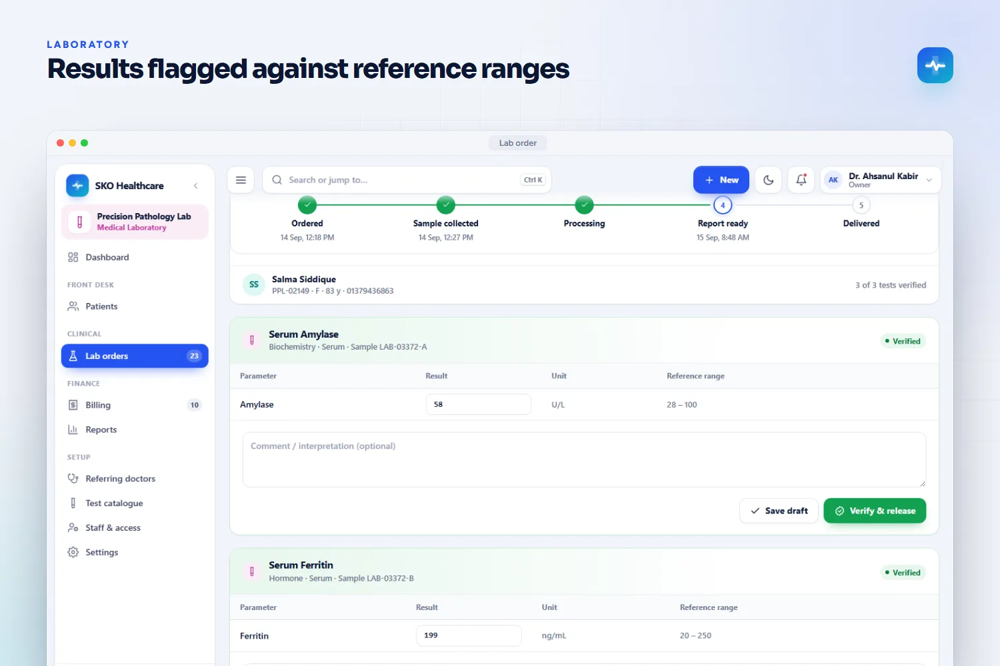 Lab results flagged against reference ranges</td>
</tr>
<tr>
<td width="50%" valign="top">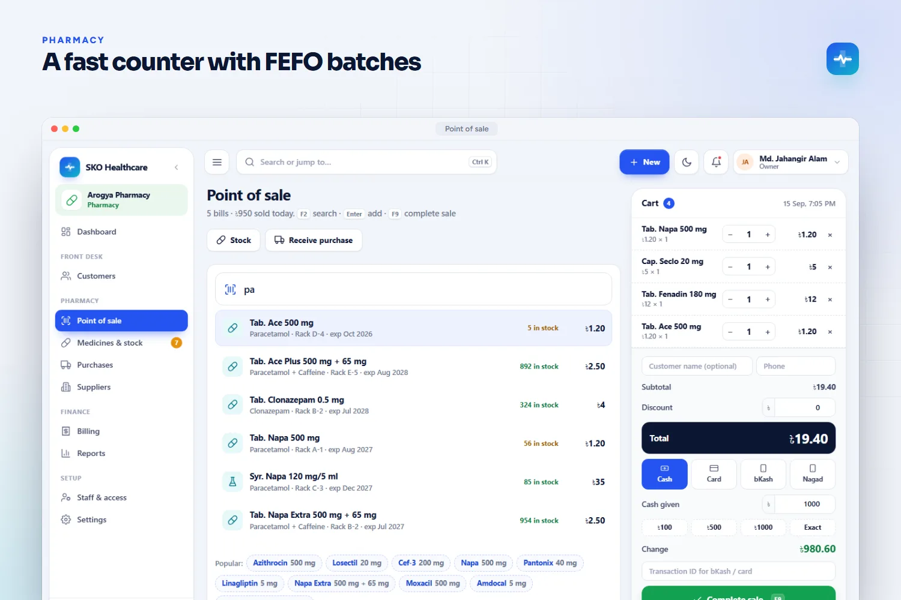 Pharmacy point of sale with first-expiry-first batches</td>
<td width="50%" valign="top">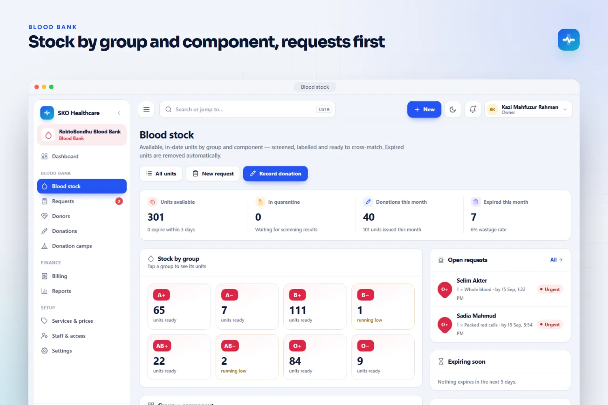 Blood bank stock by group and component</td>
</tr>
<tr>
<td width="50%" valign="top">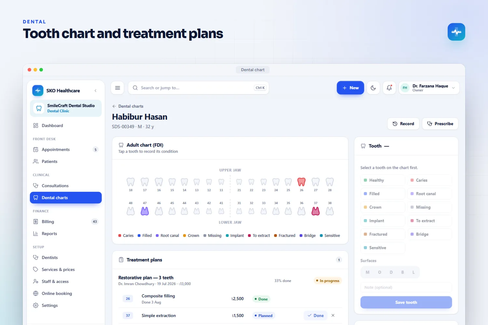 Dental tooth chart and treatment plans</td>
<td width="50%" valign="top">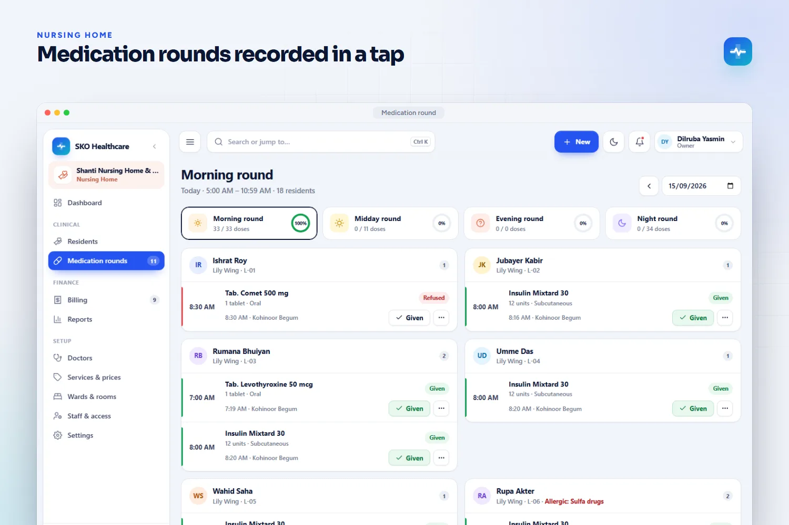 Nursing home medication round</td>
</tr>
<tr>
<td width="50%" valign="top">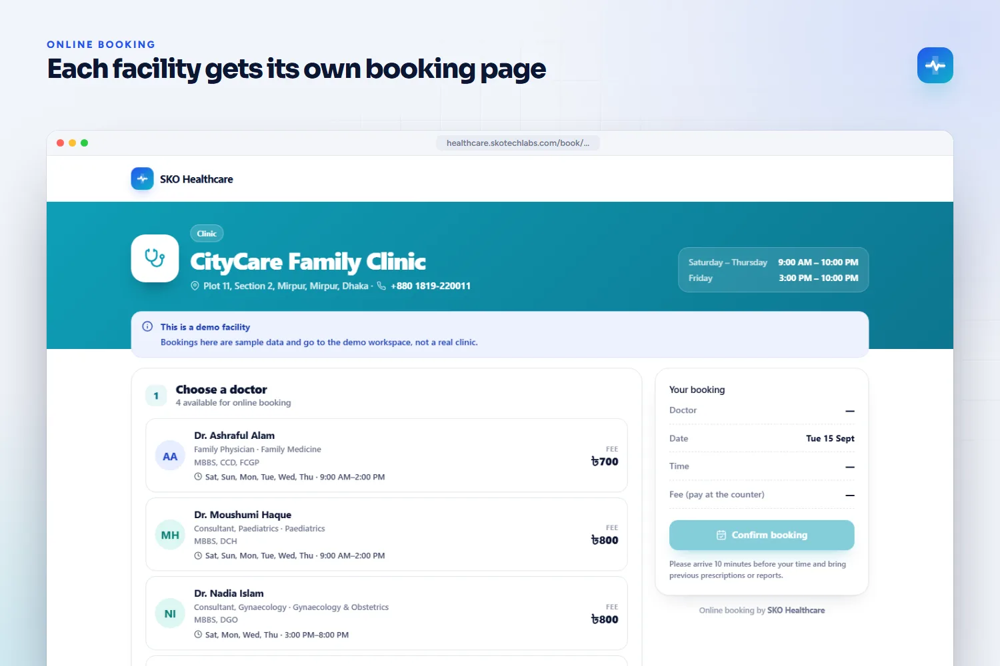 Online booking page of a facility</td>
<td width="50%" valign="top">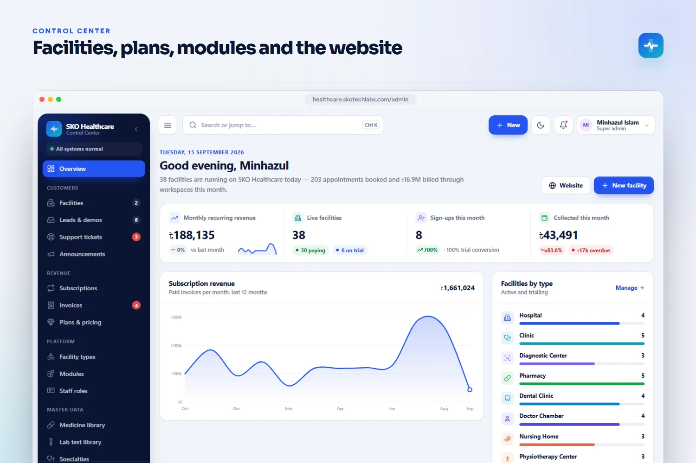 SKO Control Center overview</td>
</tr>
</table>

> See it running: **[healthcare.skotechlabs.com](https://healthcare.skotechlabs.com)**

## Technology Stack

## Source Code & Licensing

This repository is the public showcase for **SKO Healthcare**. The production source code is proprietary and is maintained privately by SKO TechLabs.

Interested in this product for your business? We offer:

- **Ready-to-launch deployment** of SKO Healthcare under your own brand and domain
- **Customisation** of features, workflows, languages and integrations to fit how you work
- **Custom development** of a new product built on the same foundations
- **Ongoing support**, hosting, maintenance and feature roll-outs after launch

## Get in Touch

---

© 2026 <a href="https://skotechlabs.com">SKO TechLabs</a> · Dhaka, Bangladesh · Building intelligent digital solutions

